<p align="center">
  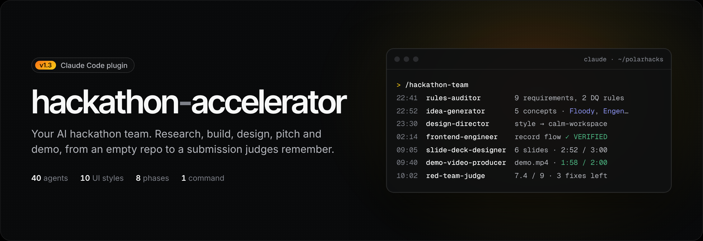
</p>

<p align="center">
  <a href="https://github.com/FilledDown/hackathon-accelerator/actions/workflows/test.yml"></a>
  
  
  
  
  
</p>

**hackathon-accelerator** is a Claude Code plugin that acts as your whole hackathon team. You bring the hackathon link. It reads the rules, figures out what the judges are scoring, helps you choose an idea worth building, plans it, writes and debugs the code with you, polishes the UI, tests the demo, writes the Devpost and pitch, and then runs a mock judging panel against your actual project before you submit.

Most "AI hackathon helpers" are one big prompt. This is an orchestrator skill plus 40 specialist agents that share project files, disagree with each other, and get called only when they're useful. If you ask a quick question, you get a quick answer. The full council only shows up for big decisions.

It also ships a **UI skill** with 10 style directions reverse-engineered from products like Linear, Stripe, Notion, Resend, Aesop and Teenage Engineering, so your demo looks like a funded product instead of a template. It animates every button, card and image, finds licensed photos, builds a timed pitch deck (in Canva or offline), records a captioned demo video of your real app, and shows you which agent did what.

```
/plugin marketplace add FilledDown/hackathon-accelerator
/plugin install hackathon-accelerator@hackathon-accelerator
```

---

## Contents

- [What it does](#what-it-does)
- [Install](#install)
- [Your first session](#your-first-session)
- [Example prompts](#example-prompts)
- [The 8 phases](#the-8-phases)
- [UI that doesn't look AI-generated](#ui-that-doesnt-look-ai-generated)
- [Pitch deck and demo video](#pitch-deck-and-demo-video)
- [See who did what](#see-who-did-what)
- [Light on tokens](#light-on-tokens)
- [The coding assistant](#the-coding-assistant)
- [The agents](#the-agents)
- [Project memory files](#project-memory-files)
- [Honesty checks](#honesty-checks)
- [Scripts](#scripts)
- [Optional integrations](#optional-integrations)
- [Windows notes](#windows-notes)
- [Updating](#updating)
- [FAQ](#faq)
- [Contributing](#contributing)
- [Limitations](#limitations)

---

## What it does

<p align="center">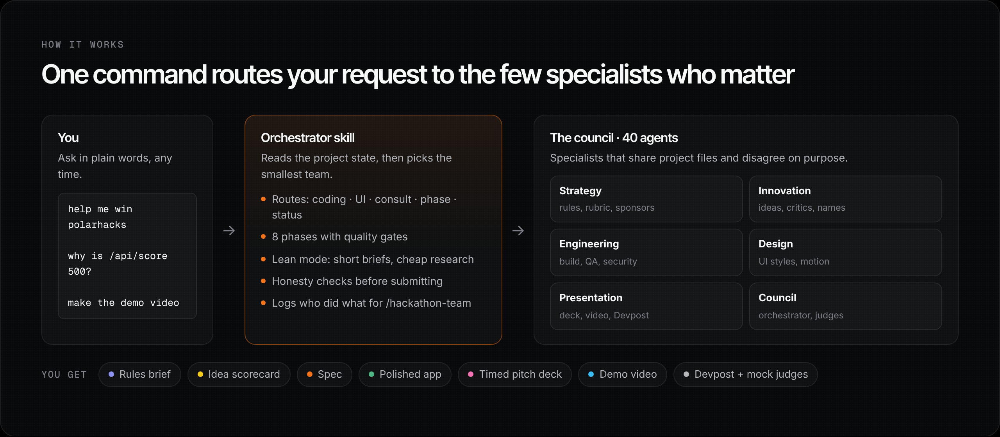</p>

- **Researches the competition.** It reads the official rules, prize tracks and judging criteria, and studies past winners. Every fact goes into `HACKATHON_BRIEF.md` with its source. Anything it couldn't confirm gets tagged `[UNVERIFIED]` instead of being guessed.
- **Picks an idea that can win.** It generates 3 to 5 genuinely different concepts. An originality critic looks for prior art, a feasibility analyst estimates hours, and each idea is scored against the real rubric weights. You make the final call.
- **Keeps scope under control.** The MVP is one core user journey plus one standout feature. Scope freezes after planning, and checkpoints at 25/50/70/85/95% of your time tell you when to cut.
- **Builds with you.** A coding assistant is available the whole time. It reads your repo before changing anything, debugs by reproducing the problem first, checks unfamiliar APIs against the docs, and tells you when a feature isn't worth the time.
- **Makes the demo reliable.** Seeded realistic data, a demo mode, fallbacks on every external API call, a reset script, and three cold-start rehearsal runs.
- **Makes it look like a real product.** Ten style directions, component animations (React or vanilla), licensed images with credits, and an anti-slop audit.
- **Writes and records the submission.** Devpost entry, a pitch timed to your slot (3 minutes? it budgets every second), a deck in Canva or an offline HTML deck with Q&A backup slides, a captioned demo video recorded from your running app, the README, and answers to likely judge questions.
- **Judges you before the judges do.** Three or four simulated judges (technical, sponsor, impact, design) score the actual repo against the official rubric and give you a ranked fix list.

---

## Install

### Requirements

- [Claude Code](https://docs.claude.com/en/docs/claude-code) (any recent version)
- Python 3.9 or newer, for the helper scripts. They use the standard library only, so there's nothing to `pip install`.
- Git, if you want to clone it or contribute

### Option A: install from GitHub (recommended)

Run these inside Claude Code:

```
/plugin marketplace add FilledDown/hackathon-accelerator
/plugin install hackathon-accelerator@hackathon-accelerator
```

Restart Claude Code. Check that it worked:

```
/plugin
```

You should see `hackathon-accelerator` in the installed list. To see the team, run `/hackathon-accelerator:team` (the roster, plus who has done what in the current project).

### Option B: run it from a local folder

This is useful when you're changing the plugin itself:

```bash
git clone https://github.com/FilledDown/hackathon-accelerator.git
cd your-hackathon-project
claude --plugin-dir /path/to/hackathon-accelerator
```

### Get the short commands

Claude Code puts the plugin name in front of plugin skills, so out of the box the command is:

```
/hackathon-accelerator:hackathon-accelerator
```

To use just `/hackathon-accelerator` and `/hackathon-team`, install the shortcuts once. The easiest way is to ask for them inside Claude Code:

```
install the hackathon-accelerator shortcut
```

Or run the installer yourself from a clone of this repo:

```bash
python tools/install_shortcut.py
```

This copies two tiny forwarding skills into `~/.claude/skills/` (`/hackathon-accelerator` and `/hackathon-team`). They only run when you type them, so they never compete with the real skills. To remove it, run `python tools/install_shortcut.py --remove`. Restart Claude Code after either one.

---

## Your first session

**1. Make a folder for your project and open Claude Code in it.**

```bash
mkdir polarhacks-app
cd polarhacks-app
claude
```

**2. Start the accelerator.**

```
/hackathon-accelerator https://polarhacks.devpost.com
```

You can also just talk to it normally. "I'm doing PolarHacks this weekend with two friends, help me plan" triggers the skill too.

**3. Answer a few questions.** It asks for the deadline (with timezone), team size, what everyone is good at, and any tracks you care about.

**4. Let it set up the project.** It creates the memory files (more on those [below](#project-memory-files)), checks which tools you have installed, then starts researching. You'll get a short summary, and the details go into files you can open.

**5. Keep going.** It walks you through the phases in order, but you can jump anywhere. If you already have an idea and half an app, say so and it starts from there.

---

## Example prompts

You don't need special syntax. These are the kinds of things you can say.

**Starting out**

```
/hackathon-accelerator https://example.devpost.com
I saved the rules page as rules.html, read it and tell me what judges care about
We have 36 hours, 3 people, React and Python. What should we build?
I already have an idea: a piano practice app that listens and flags rushed bars. Score it.
```

**Planning**

```
Compare our top two ideas against the rubric
Write the product spec and architecture
Which sponsor prizes are actually worth going for?
Is this architecture a good idea or am I overcomplicating it?
```

**Building (the coding assistant handles these)**

```
Help me implement the upload flow end to end
Why is /api/score returning a 500?
The frontend isn't talking to the backend
Explain what this hook does
Can you add real-time collaboration?
This is taking too long. What's the fastest way to get it working?
Inspect the repo and tell me what needs fixing before the demo
```

**Finishing**

```
Where are we? What should I do next?
Polish the UI on the demo path
Run QA on the whole demo
Write the Devpost submission
Write a 3 minute pitch and the questions judges will ask
Simulate judging
Run the final submission check
```

### What pushback looks like

The coding assistant will disagree with you when a request is likely to hurt your project. It still leaves the final decision to you. Here's an illustrative exchange late in a hackathon:

> **You:** can you add real-time multiplayer so two people can edit the map together?
>
> **Assistant:** We're about 75% through with 9 hours left, which is past the feature freeze in the build plan. Real CRDT sync is likely 5 to 6 hours and puts the working map at risk. Collaboration isn't in the rubric, but Design (15%) and Presentation (10%) still have room to improve. A cheaper option: fake a second cursor driven by a seeded "teammate" for the demo (about 30 minutes, clearly labeled as simulated). Want me to do that, or do you still want the real thing?

---

## The 8 phases

<p align="center">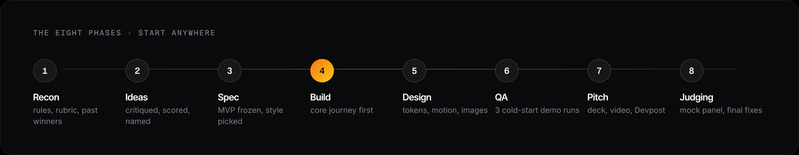</p>

| # | Phase | What happens | You get | It won't move on until |
|---|---|---|---|---|
| 1 | Recon | Rules, rubric, deadlines, prizes, sponsors, past winners | `HACKATHON_BRIEF.md`, `COMPETITIVE_ANALYSIS.md` | Deadline, deliverables, criteria and DQ rules are each sourced or marked unverified |
| 2 | Ideas | Generate, critique, check feasibility, score | `IDEA_SCORECARD.md` | Every surviving idea has passed a critic and a feasibility check, and you've picked one |
| 3 | Spec | Product spec, architecture, build plan, risks | `PRODUCT_SPEC.md`, `ARCHITECTURE.md`, `BUILD_PLAN.md` | MVP is one journey plus one standout feature, and at least 20% of time is kept for polish and the pitch |
| 4 | Build | Core journey first, then sponsor tech, standout feature, data, fallbacks, tests | Working code | Each feature is marked VERIFIED only after it actually ran |
| 5 | Design | Hierarchy, type, layout, states, motion, accessibility | A demo path that looks intentional | Loading, empty and error states exist on the demo path |
| 6 | QA | Journeys, error cases, security, performance, pre-mortem | `submission/FINAL_CHECKLIST.md` | Demo runs 3 times in a row from a cold start and no secrets are in the repo |
| 7 | Pitch | Story, Devpost, slides, video script, README, judge Q&A | Everything in `submission/` | `validate_submission.py` passes |
| 8 | Judging | 3 to 4 simulated judges score the real repo | `submission/JUDGING_SIMULATION.md` | The fixes that fit in the time left are done |

---

## UI that doesn't look AI-generated

Most hackathons are judged on a working app or website, and judges can spot generic AI output (purple gradients, three identical icon cards, Lorem ipsum) in seconds. The plugin's second skill, **hackathon-ui**, gives Claude a real design process:

1. **Pick one style direction** from 10, each reverse-engineered from top product sites.
2. **Tokens before components.** Every color, font, radius and shadow comes from one file.
3. **Build the demo-path screens** with realistic data and loading, empty and error states.
4. **Add purposeful motion**, including a staged "hero moment" for the demo.
5. **Verify by looking.** It screenshots the app at desktop and mobile widths and runs `ui_audit.py`, which flags placeholder copy, slop gradients, hardcoded colors, missing alt text and more.

Each style comes with tokens, type rules, layout signatures, component details, motion, do's and don'ts, a ready prompt, and a working demo page for an invented product. These are the demo pages:

| | |
|---|---|
| 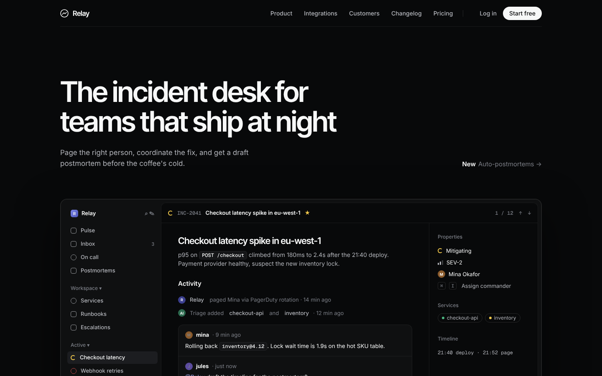<br>**precision-dark** · Linear, Raycast, Vercel, Cursor | 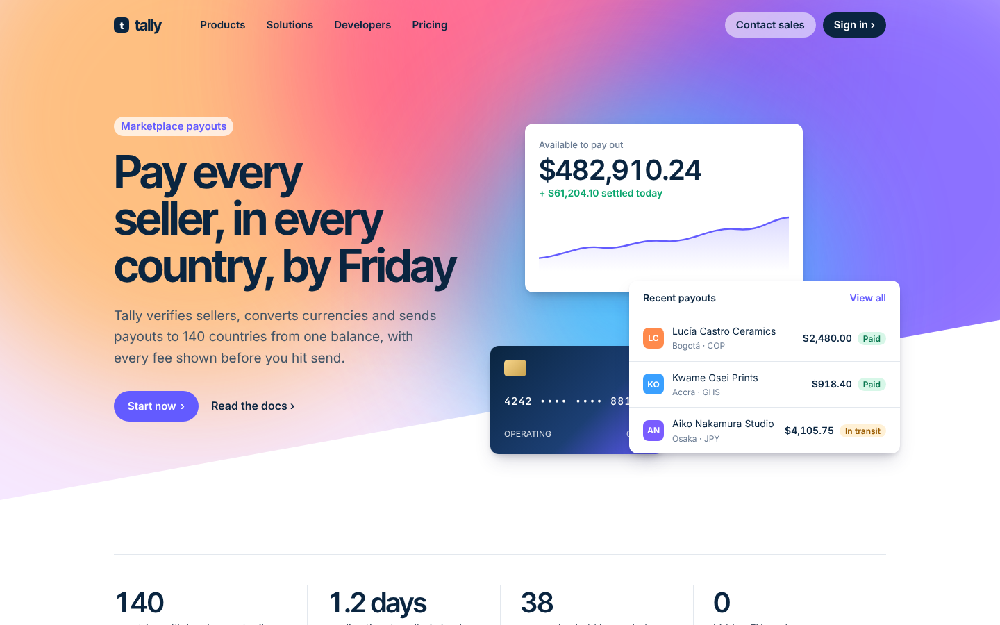<br>**fintech-gradient** · Stripe, Mercury, Ramp, Brex |
| 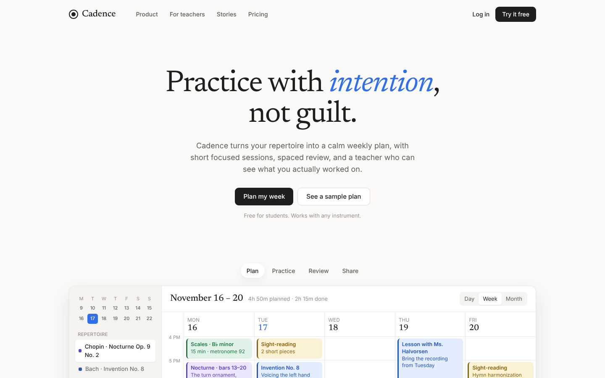<br>**calm-workspace** · Notion, Attio, Notion Calendar, Pitch | 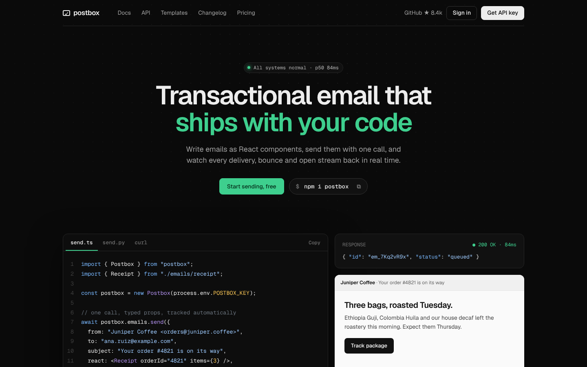<br>**dev-platform** · Resend, Supabase, Neon, Railway |
| 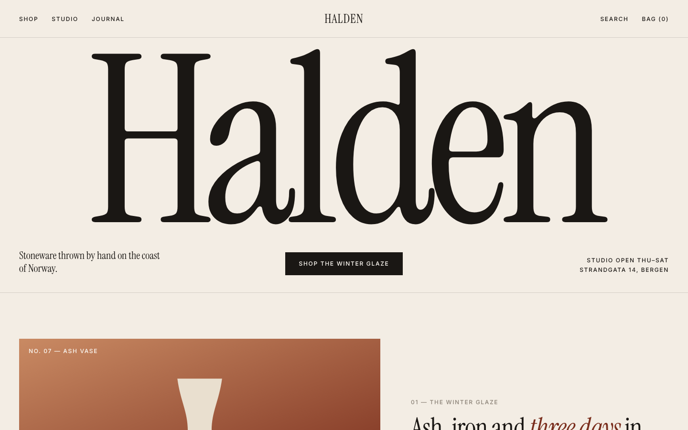<br>**editorial-luxe** · Aesop, COS, Apple, Squarespace templates | 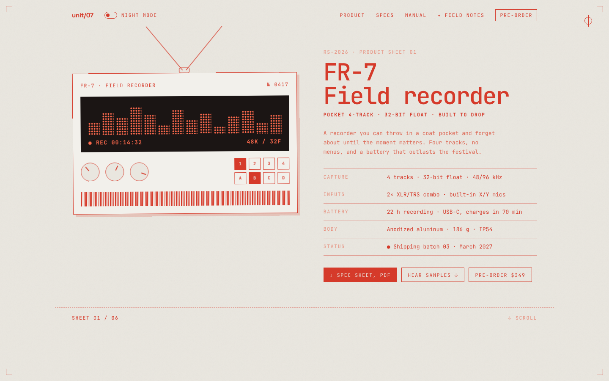<br>**spec-sheet** · Teenage Engineering, Nothing |
| 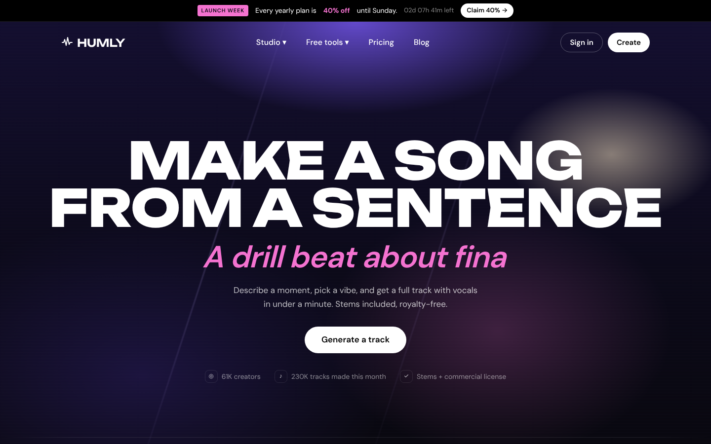<br>**bold-media** · music, streaming, gaming, sports retail | 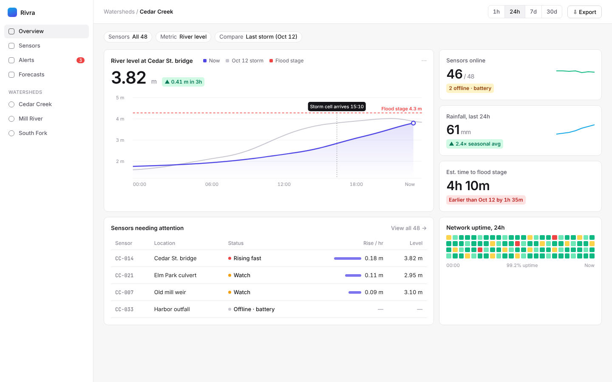<br>**data-dashboard** · Datadog, Grafana, Tremor, PostHog |
| 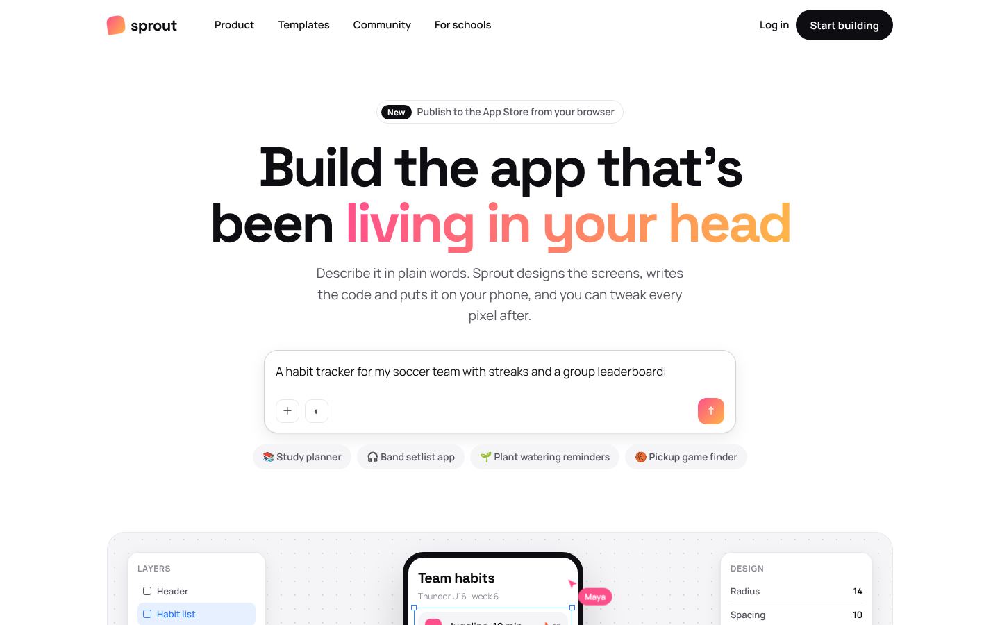<br>**playful-builder** · Framer, Webflow, Lovable, Replit | **immersive** · Lusion, Immersive Garden, Spline, Rive<br><br>Guidance only, with no demo page: 3D and scroll storytelling are high-risk in a hackathon, so the skill says when it's worth it and how to keep a static fallback. |

### Animations on every component

<p align="center">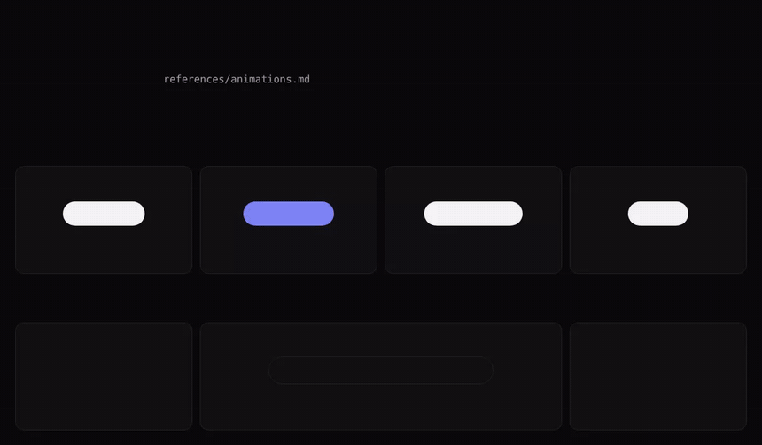</p>

`references/animations.md` has a recipe for buttons (press, shine, loading → success, magnetic), links (underline draw, sliding nav pill), cards (lift, spotlight, tilt, expand-to-detail, stagger on scroll), images (blur-up, reveal mask, zoom, before/after), text (split reveal, streaming, counters), tabs, toggles, inputs, toasts and success states. Each recipe comes in CSS, React (**Motion**) and vanilla (**anime.js**) versions. It also covers ready-made components from **React Bits** and **Kokonut UI**, and charts with **ECharts**. All of it is working in `assets/showcase/motion-gallery.html`.

### Licensed images, credited automatically

```bash
python skills/hackathon-ui/scripts/fetch_images.py "hands on piano keys warm light" --count 4 --out public/images
```

Downloads commercially usable photos from **Openverse** (no key needed), or from **Pexels** and **Unsplash** if you add a free API key, and writes `CREDITS.md` with every attribution. `references/images.md` covers making photos look like one consistent set, keeping them fast, and when the product UI is the better image.

### Built for products, not dashboards
Most hackathon projects are a product: something you put in, magic happens, and a result comes out. The skill designs that core loop first (onboarding, input, working state, result, sharing). The dashboard style is only a reference for the one chart a product might need.

The demo pages are original. Product names, copy and art are invented. They borrow design patterns, never logos or assets. Open any `.html` file in `skills/hackathon-ui/assets/showcase/` to see it live.

**Use it directly** in any project, hackathon or not:

```
/hackathon-accelerator:hackathon-ui make the dashboard look like a real product
```

or just say "improve the frontend" or "make this landing page look good." Inside a hackathon project, the design agents use it automatically in Phases 3 and 5.

**Got UI/UX Pro Max or another design skill installed?** They work together. Claude reads the other skill for palette and font exploration, while hackathon-ui owns the style choice, the token rule and the audit, so the result stays consistent.

---

## Pitch deck and demo video

**Timed to your slot.** Tell it "we have 3 minutes with a live demo" and `time_plan.py` budgets every segment in seconds, spoken words (at 140 wpm) and slides. The demo gets at least half the time and starts before 40 seconds. It checks your script against the clock and flags overruns.

**The deck.** If Canva is connected, it builds the presentation in Canva in your product's style and exports a PDF. If not, it uses an offline HTML deck with a built-in per-slide timer (`T`), speaker notes (`N`) and one-click PDF export (`P`). Either way, it adds 2–4 **appendix slides answering the questions judges usually ask** ("what if the AI is wrong?", "what did you build this weekend?").

<p align="center">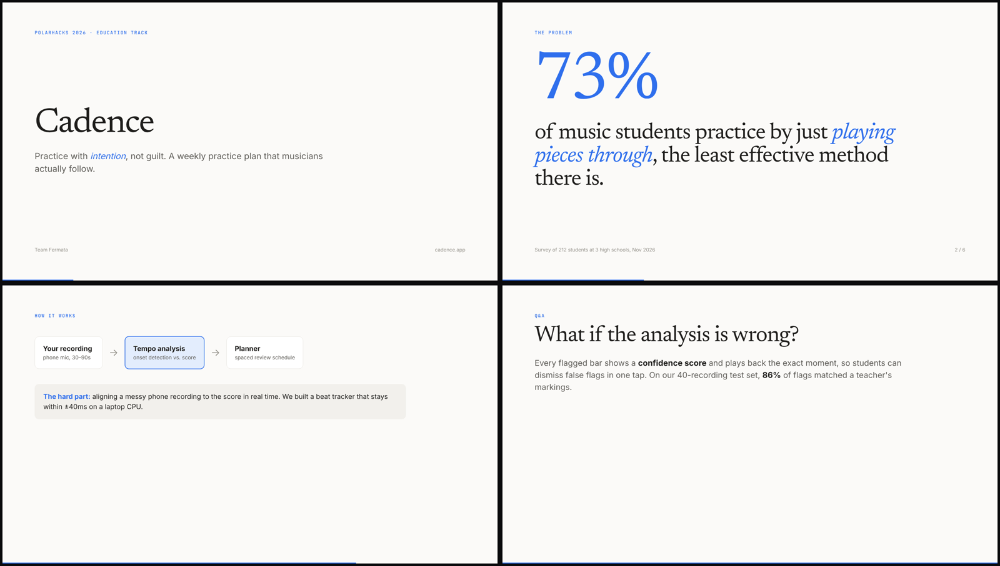</p>

To connect Canva (optional, needs a Canva account):
```bash
claude mcp add --transport http Canva https://mcp.canva.com/mcp
```
Then run `/mcp` in Claude Code and sign in.

**The demo video.** A Playwright script drives your *real running app* with a visible, smoothly moving cursor, click ripples, captions and a spotlight on the hero moment. Title, problem, impact and end cards render from HTML, and `make_video.py` stitches everything into a 1080p MP4 with crossfades and optional music or narration. It fails if you're over the time limit. Since the recording is a script, re-recording after a bug fix takes a minute.

<p align="center">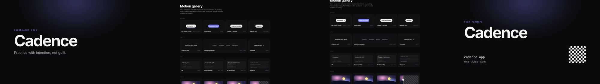</p>

```bash
python skills/hackathon-accelerator/scripts/make_video.py video/cards/title.png:3 video/raw/demo.webm@1-80 video/cards/end.png:4 --out submission/demo.mp4 --limit 120
```

---

## See who did what

Every time an agent runs, the plugin logs it automatically through a hook. You can see the whole history any time:

```
/hackathon-accelerator:team        (or /hackathon-team with the shortcut installed)
```

Example output:

```text
| Time  | Agent             | Team        | Task                          | Result                                  | Took   |
|-------|-------------------|-------------|-------------------------------|-----------------------------------------|--------|
| 22:41 | rules-auditor     | strategy    | Audit PolarHacks rules        | Wrote research/rules-audit.md.          | 1m 30s |
| 02:14 | frontend-engineer | engineering | Build practice calendar       | Calendar screen VERIFIED in browser.    | 6m 12s |
| 03:05 | hackathon-coding… | always      | Fix CORS between web and api  | Added origin; verified fetch works      | —      |
```

It also lists the full roster of 40 agents, with a ✓ next to the ones that have worked on your project. Logging only happens in hackathon projects (folders with `PROGRESS.md`), never in your other repos.

---

## Light on tokens

The plugin keeps its fixed cost small, so more of your usage goes to actual work:
- **About 1,000 tokens of always-loaded descriptions** for 40 agents and 3 skills (down from about 3,200 in v1.2).
- **Lean mode by default:** quick questions use 0–1 agents, briefs and handoffs are capped at about 150 words, details go into files instead of chat, and read-only research agents can run on a cheaper model.
- **Scripts instead of reading:** `generate_project_report.py` summarizes the project state in a few lines, so Claude doesn't re-read every doc.
- **Progressive disclosure:** playbooks load only when their phase starts.

---

## The coding assistant

The coding assistant works in every phase. You never have to switch modes to use it.

Once a project is set up, a short block in your project's `CLAUDE.md` makes every Claude Code session in that folder follow the coding-assistant rules. In practice, you open Claude Code and ask normally.

What it does differently from a plain chat:

- **Reads first.** It checks `PROGRESS.md` and the files involved before answering anything that depends on project history. It won't rewrite working code without a reason.
- **Debugs with a method.** It reproduces the problem, finds the root cause, makes the smallest reliable fix, re-runs, and explains what happened in plain words. It doesn't keep editing until the error goes away.
- **Checks the docs.** It verifies unfamiliar APIs with Context7 or the official docs before writing calls. It doesn't make up method names.
- **Thinks about the score.** Before a big feature, it asks whether the feature raises the score, whether it can be demoed, and whether it's worth the hours left.
- **Explains as it goes.** It gives short, practical explanations of anything you might not know yet.
- **Keeps records honest.** `PROGRESS.md` only says VERIFIED when something actually ran.

For a session dedicated to coding:

```bash
claude --agent hackathon-accelerator:hackathon-coding-assistant
```

---

## The agents

All 40 agents are in [`agents/`](agents/). Research and review agents get limited tools (read, search the web, and write their own report). Builder agents get every tool you have, including MCP servers like Context7 or Playwright when they're installed.

<details>
<summary><b>Council</b> (3): coordination and the toughest critic</summary>

| Agent | Job |
|---|---|
| `chief-orchestrator` | Decides who works on what, settles disagreements, guards the clock. Can run as your main session agent. |
| `competition-director` | Keeps the team aiming at the rubric instead of just building features |
| `red-team-judge` | Independent critic. Audits claims against the code, scores the rubric, asks the hard questions. Takes a judge persona in Phase 8. |
</details>

<details>
<summary><b>Strategy</b> (6): research the competition</summary>

| Agent | Job |
|---|---|
| `competition-analyst` | Event facts: format, tracks, timeline, judges |
| `rules-auditor` | Quotes every requirement and DQ rule, then runs the final compliance audit |
| `rubric-analyst` | Turns criteria and weights into priorities and scorecard weights |
| `past-winners-researcher` | What won before, with counts, labeled as patterns and not as rules |
| `sponsor-track-strategist` | Which sponsor prizes are worth it, and how to make the sponsor tech essential |
| `judge-psychology-analyst` | How judging actually goes, plus judge personas for Phase 8 |
</details>

<details>
<summary><b>Innovation</b> (6): find and stress-test the idea</summary>

| Agent | Job |
|---|---|
| `idea-generator` | 8 to 12 raw concepts, narrowed to the best 3 to 5 |
| `problem-discovery-researcher` | Real problems with sourced evidence of pain |
| `originality-critic` | Finds prior art and argues against generic ideas |
| `feasibility-analyst` | Honest hour estimates, unknowns, and a scoped-down fallback |
| `idea-scoring-analyst` | Weighted scorecard built from the critics' evidence |
| `product-manager` | Writes the spec and says no to scope creep |
</details>

<details>
<summary><b>Engineering</b> (12): build it, break it, fix it</summary>

| Agent | Job |
|---|---|
| `system-architect` | Stack, interfaces, build plan, file ownership for parallel work |
| `frontend-engineer` | Screens wired to real endpoints, with loading, empty and error states |
| `backend-engineer` | Endpoints that match the contract, with validation and clear errors |
| `ai-ml-engineer` | Model calls, prompts, RAG, and a small eval set with measured results |
| `database-engineer` | Schema, realistic seed data, reset script |
| `api-integration-engineer` | Sponsor and third-party APIs, wrapped with timeouts and fallbacks |
| `devops-engineer` | One-command startup, deployment, secrets kept out of git |
| `qa-testing-engineer` | Runs everything and reports what passed, what failed, and what wasn't run |
| `performance-engineer` | Measures the demo path and fixes what a judge would notice |
| `security-reviewer` | Leaked keys, auth holes, injection, unsafe CORS |
| `debugging-specialist` | Hard bugs: reproduce, isolate, minimal fix, verify |
| `code-review-specialist` | Catches contract mismatches and integration bugs |
</details>

<details>
<summary><b>Design</b> (6): make it look intentional</summary>

| Agent | Job |
|---|---|
| `design-director` | Sets the visual direction, audits screens, prioritizes polish |
| `ui-ux-specialist` | Flow, hierarchy, copy, empty and error states |
| `visual-design-specialist` | Type, color, spacing, design tokens, assets |
| `interaction-designer` | Feedback, motion, and making the key moment land |
| `accessibility-reviewer` | Contrast, keyboard navigation, focus, semantics |
| `demo-experience-engineer` | Demo script, demo mode, reset, rehearsal timing |
</details>

<details>
<summary><b>Presentation</b> (6): tell the story</summary>

| Agent | Job |
|---|---|
| `pitch-director` | Story structure, timing, rubric map, judge Q&A |
| `technical-storyteller` | Makes hard engineering visible and explainable |
| `slide-deck-designer` | 6 to 8 slides with speaker notes |
| `demo-video-producer` | Timed video script and shot list within the length limit |
| `devpost-submission-writer` | Every Devpost field, plus the README |
| `presentation-critic` | Reads everything like a tired judge and suggests exact edits |
</details>

<details>
<summary><b>Always on</b> (1)</summary>

| Agent | Job |
|---|---|
| `hackathon-coding-assistant` | Your senior engineer for the whole event |
</details>

### How they work together

- **Only what's needed.** A quick question uses 0 or 1 agents, a coding task uses up to 2, and a phase uses its own team. The full council only meets for big decisions like choosing the idea or the final judging round.
- **Files, not chat.** Agents read and write the shared project files. Reports go into `research/` and `reviews/`, and you get a short summary.
- **Disagreement is on purpose.** When agents disagree, the orchestrator weighs expected score per hour left, treats demo risk as a heavy cost, decides, and logs it in `DECISION_LOG.md`. You can overrule anything.
- **No collisions.** Agents only run in parallel when they edit different files and the interface between them is written down first.

---

## Project memory files

These files live in your project root. They're how agents coordinate, and how a new session picks up where you left off.

```
your-project/
├── HACKATHON_BRIEF.md       rules, deadline, criteria, prizes, all sourced
├── COMPETITIVE_ANALYSIS.md  past-winner patterns, crowded vs open idea areas
├── IDEA_SCORECARD.md        candidate ideas + the live scorecard
├── PRODUCT_SPEC.md          problem, user, MVP, demo scenario, out of scope
├── ARCHITECTURE.md          stack, interfaces, dependencies, demo mode
├── BUILD_PLAN.md            milestones, tasks, who owns which files, cut list
├── PROGRESS.md              features + status, bugs, deadline, detected tools
├── DECISION_LOG.md          every big decision and why
├── RISK_REGISTER.md         what could go wrong and the plan for it
├── CLAUDE.md                gets a small block so every session knows the context
├── research/  reviews/      agent reports
├── app/  tests/  assets/
└── submission/
    ├── README.md  DEVPOST.md  PITCH.md
    ├── DEMO_SCRIPT.md  SLIDES.md
    └── FINAL_CHECKLIST.md
```

`PROGRESS.md` is the single source of truth for what works. Each feature has one status:

| Status | Meaning |
|---|---|
| `VERIFIED` | Someone ran it and saw it work |
| `IMPLEMENTED` | The code exists but hasn't been run |
| `IN_PROGRESS` | Being built |
| `PLANNED` | Not started |
| `SIMULATED` | Faked or mocked for the demo |
| `BLOCKED` | Stuck |
| `CUT` | Dropped on purpose |

---

## Honesty checks

Judges notice when a pitch claims something the demo doesn't show. So the plugin checks your submission against `PROGRESS.md` before you submit.

Here's real output from `validate_submission.py` on the project with problems from the test fixtures:

```text
[ERROR] claims       'SMS notifications' is PLANNED but appears as a feature in DEVPOST.md [Devpost Submission / What it does]
[ERROR] secrets      .env exists but is not listed in .gitignore.
[ERROR] secrets      Possible OpenAI/Anthropic-style key in config.py ('sk-proj-...'). Remove it and rotate the key.
[ERROR] submission   submission/DEVPOST.md:3 placeholder 'TODO': TODO write a story here about why we built this project
[ERROR] submission   submission/DEVPOST.md:8 placeholder '<link>': - Demo video: <link>
[WARN ] claims       'Insurance quote lookup' is SIMULATED but DEVPOST.md doesn't say it's mocked

5 error(s), 1 warning(s). FAIL
```

And here's the status report from `generate_project_report.py` for the good fixture project:

```text
Phase: 7 — Pitch and submission  ·  Deadline: 2026-03-15 21:00 MST  ·  Time left: 9h 0m  ·  Elapsed: 75.0%
Next checkpoint: 85% - submission materials drafted

## Features
VERIFIED: 2, PLANNED: 1, SIMULATED: 1
Demo-critical verified: 2/2

## Scorecard (1–9, weighted)
Current (verified only): 6.0  ·  Projected: 6.8

## ⚠ Warnings
- Past feature freeze (70%) with PLANNED features remaining - move them to 'What's next' or CUT.
```

The rules the whole system follows:

- It never invents research, sources, API features or test results. "Not verified" is always an acceptable answer.
- It never says something was tested unless a command actually ran.
- Verified, planned and simulated features stay clearly separated everywhere, including the pitch.
- Scope shrinks as time runs out. It won't trade demo reliability for one more feature.

---

## Scripts

The accelerator scripts are in `skills/hackathon-accelerator/scripts/`, and the UI audit is in `skills/hackathon-ui/scripts/`. Claude runs them for you, but you can run them yourself too. Use `python3` on macOS and Linux, or `python` on Windows.

| Script | What it does | Example |
|---|---|---|
| `init_project.py` | Creates the memory files and the `CLAUDE.md` block. Never overwrites existing files. | `python init_project.py . --deadline "2026-12-06 17:00 America/Denver"` |
| `detect_environment.py` | Finds your MCP servers, skills, plugins and CLIs, and records them in `PROGRESS.md` | `python detect_environment.py . --write` |
| `fetch_hackathon_docs.py` | Saves hackathon pages (URLs or saved HTML files) as clean text | `python fetch_hackathon_docs.py https://x.devpost.com/rules --out research/raw` |
| `extract_submission_requirements.py` | Pulls out the deadline, team size, criteria and weights, deliverables, DQ rules and sponsor requirements, as JSON plus markdown | `python extract_submission_requirements.py research/raw --out research/requirements.json` |
| `validate_submission.py` | The honesty and compliance gate described above | `python validate_submission.py . --requirements research/requirements.json --strict` |
| `generate_project_report.py` | Time left, checkpoint, feature counts, risks, scorecard, warnings | `python generate_project_report.py .` |
| `time_plan.py` | Second-by-second plan for a 2/3/5-minute pitch or video, plus a script length check | `python time_plan.py --minutes 3 --format live-demo --check .` |
| `make_video.py` | Stitches cards and recordings into a 1080p MP4 with crossfades and music; enforces the time limit | `python make_video.py cards/title.png:3 raw/demo.webm --out demo.mp4 --limit 180` |
| `team_log.py` | Who did what: the agent activity log plus roster | `python team_log.py . --roster` |
| `hackathon-ui/scripts/fetch_images.py` | Licensed photos from Openverse, Pexels or Unsplash, with credits | `python fetch_images.py "rainy street at night" --count 4` |
| `hackathon-ui/scripts/ui_audit.py` | Anti-slop audit of your frontend source: placeholder copy, slop gradients, hardcoded colors, type scale, alt text, focus styles, reduced motion | `python ui_audit.py app/src` |

The requirements extractor works by pattern matching. It gives the agents a head start and records its evidence for each item, but always check its output against the official rules. The `rules-auditor` agent does that check as part of Phase 1.

---

## Optional integrations

The plugin works with nothing extra installed. If you do have these, it uses them, but only after `detect_environment.py` confirms they're there:

| Tool | Used for |
|---|---|
| Context7 | Checking library and API docs before writing code |
| Firecrawl | Pulling whole hackathon sites (rules, FAQ, prizes) in one go |
| Playwright MCP | Clicking through the demo and taking screenshots during QA |
| GitHub MCP | Issues, PRs and repo management |
| Serena / Graphify | Navigating and mapping large codebases |
| UI/UX Pro Max, Taste, frontend-design | Design polish in Phase 5 |
| Beads, Vibe Kanban, Planning with Files | Task tracking |
| Canva MCP | Building the pitch deck in Canva and exporting it as a PDF |
| ffmpeg + Playwright | Recording and stitching the demo video |
| Pexels / Unsplash API keys | More photo sources (Openverse works without a key) |
| Image-generation MCP | Generated images, credited as AI-generated |
| Agent Teams (experimental) | Direct debate between agents in Phases 2 and 8 |

---

## Windows notes

Everything works on Windows. A few things to know:

- Use `python` instead of `python3`, or `py -3` if `python` isn't found.
- For timezone names like `America/Denver`, install the timezone database with `pip install tzdata`. Without it, the scripts fall back to a built-in table of standard offsets, which can be an hour off during daylight saving time. You can also write deadlines with an offset, like `2026-12-06 17:00 -07:00`.
- If Windows "Extract All" puts the folder inside a second folder with the same name, `cd` one level deeper.
- For the demo video, install ffmpeg with `winget install Gyan.FFmpeg`, then reopen PowerShell.
- Setting environment variables in PowerShell looks like `$env:DEMO_URL="http://localhost:3000"; node video/record-demo.mjs`.

---

## Updating

```
/plugin marketplace update hackathon-accelerator
/plugin update hackathon-accelerator@hackathon-accelerator
```

Then restart Claude Code. See [CHANGELOG.md](CHANGELOG.md) for what changed.

---

## FAQ

**Does this guarantee a win?**
No, and it will never claim to. It works through the rubric, scope, demo reliability and pitch so your project has the best realistic chance.

**Will it write the whole project for me?**
It will write a lot of it with you, but you stay in charge. You pick the idea, you approve scope changes, and you can overrule any recommendation. Check your hackathon's rules on AI tools too. Some events require you to disclose AI assistance, and the `rules-auditor` flags that requirement when it's in the rules.

**Do I have to use all eight phases?**
No. Jump straight to "help me debug this" or "write my Devpost". It starts at the earliest phase whose output is missing, and asks before redoing work you've already done.

**Does it use a lot of tokens?**
Much less than v1.2. See [Light on tokens](#light-on-tokens). A full phase with several agents still costs more than a single chat message, so for small questions just ask the coding assistant directly.

**Can I use it for game jams or buildathons?**
Yes. Anything with a deadline, deliverables and judging works the same way.

**Can I add my own UI style?**
Yes. Add `skills/hackathon-ui/references/styles/<name>.md` (copy the structure of an existing one), a demo page in `assets/showcase/<name>.html`, list it in `styles/index.md`, and regenerate screenshots with `tools/render-showcases` (`npm install`, then `npm run render`).

**Can I add my own agent?**
Yes. Drop a markdown file into `agents/` with the same frontmatter format as the others, add it to the roster in `skills/hackathon-accelerator/SKILL.md`, and run the structure check (see below).

---

## Contributing

Issues and pull requests are welcome.

```bash
git clone https://github.com/FilledDown/hackathon-accelerator.git
cd hackathon-accelerator

# test your changes in a real project
cd ../some-test-project
claude --plugin-dir ../hackathon-accelerator

# run the checks (same ones GitHub Actions runs on every push)
cd ../hackathon-accelerator
python skills/hackathon-accelerator/scripts/tests/validate_system.py
python -m unittest discover -s skills/hackathon-accelerator/scripts/tests
python -m unittest discover -s skills/hackathon-ui/scripts/tests
claude plugin validate .
```

GitHub Actions runs the script tests on Windows, macOS and Linux with Python 3.9 and 3.13, and runs `claude plugin validate`.

**Releasing a new version**

1. Bump `"version"` in both `.claude-plugin/plugin.json` and `.claude-plugin/marketplace.json`
2. Add an entry to `CHANGELOG.md`
3. Commit, push, then tag it: `git tag v1.2.0 && git push origin v1.2.0`
4. Optional: create a GitHub Release from the tag with the changelog notes

**Repo layout**

```
.claude-plugin/          plugin.json, marketplace.json
skills/hackathon-accelerator/
  SKILL.md               the orchestrator
  references/            12 playbooks: rubrics, MVP scope, demo engineering, presentation, demo video, naming...
  scripts/               the Python helpers + tests/ + fixtures
  assets/templates/      project memory templates + deck/deck.html
  assets/video/          record-demo.mjs, render-cards.mjs, cards.html
skills/hackathon-ui/
  SKILL.md               the UI process
  references/            foundations, components, animations, motion, images, anti-slop, inspiration, styles/ (10)
  assets/showcase/       9 style demo pages + motion-gallery.html + screenshots/
  scripts/               ui_audit.py, fetch_images.py + tests
skills/team/             /hackathon-accelerator:team
hooks/                   agent activity logging (hooks.json + agent-log.js)
agents/                  40 agent definitions
shortcut/                /hackathon-accelerator and /hackathon-team forwarding skills
tools/                   install_shortcut.py, render-showcases/ (regenerates the screenshots)
evals/                   test cases for `claude plugin eval`
docs/images/, docs/src/   README images and their HTML source
```

---

## Limitations

- **Subagents can't start other subagents.** Only your main session hands out work, so specialists recommend handoffs and the orchestrator decides.
- **Only the main session can hold a conversation.** That's why the coding-assistant rules also live in `CLAUDE.md`, so plain sessions get them.
- **Requirement extraction is heuristic.** Pages that render with JavaScript need Firecrawl, a browser tool, or a saved copy of the page.
- **Agent logging uses Claude Code hooks.** Hooks need Node (which Claude Code already requires). If your setup blocks plugin hooks, `/hackathon-accelerator:team` still shows the roster and any work logged by the main session.
- **Canva tool names vary between versions,** so Claude lists and reads the connected Canva tools before using them. Without Canva, the HTML deck is the fallback.
- **The demo video needs Playwright and ffmpeg** in your project. Apps that can't be driven in a browser (native mobile, hardware) need a manual screen recording, which the stitcher accepts.
- **Claim checking matches feature names.** It catches a planned feature that's named in the Devpost, but not a reworded description of it. The presentation critic and red-team judge cover rewording.

---

## License

[MIT](LICENSE)
