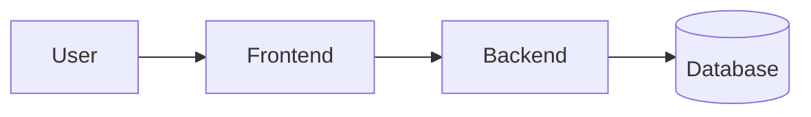

# Architecture

## Overview

## Components & ownership
| Component | Path | Owner |
|---|---|---|

## Interfaces
<!-- Routes with request/response examples, shared types, DB schema, events. Define BEFORE parallel work. -->

## External dependencies
| Service | Purpose | Docs | Auth | Limits | Fallback |
|---|---|---|---|---|---|

## Environment variables (names only; mirror in .env.example)

## Demo mode

## Known shortcuts (accepted hackathon debt)
